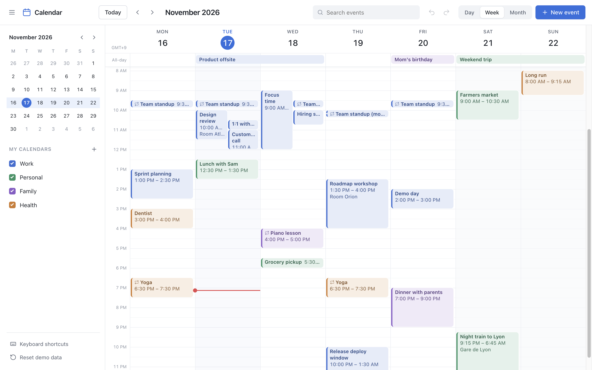

# Calendar

A personal calendar built with React and TypeScript, centred on a polished **week view**.
It keeps a clear time grid and a restrained palette, and every core action works with
the mouse, touch or keyboard.



## Features

- **Week, day and month views**, plus a mini-month navigator, a "now" indicator and today highlighting.
- **Create events** by clicking an empty slot, dragging across the grid, using **New event**, or pressing <kbd>C</kbd>.
- **Drag to reschedule** across days and times, with 15-minute snapping, a live time preview, auto-scroll near edges and <kbd>Esc</kbd> to cancel.
- **Drag either edge to change duration.** You can drag past midnight to create an overnight event.
- **All-day and multi-day events** in a dedicated row with lane stacking. Timed events of 24 hours or more show here too.
- **Overlapping events** sit side by side in columns and expand into free space.
- **Events that span midnight** split across days, with "continues" markers and an "until 1:30 AM" label.
- **Weekly recurrence**: choose weekdays, repeat every 1–4 weeks, optionally until a date. Edits, drags and deletes on a series always ask:
  **This occurrence only** or **Entire series**. A changed occurrence gets a dashed edge.
- **Calendar categories**: add, rename, recolor, delete (events move to another calendar), and show or hide each one.
- **Search** across titles, locations and notes. Results appear as a keyboard-navigable list; matches are outlined and everything else is dimmed.
- **Undo / redo** for every change (<kbd>⌘/Ctrl</kbd>+<kbd>Z</kbd>, <kbd>⌘/Ctrl</kbd>+<kbd>Shift</kbd>+<kbd>Z</kbd>), with an undo toast.
- **Local persistence**: events, calendars, the current view and hidden calendars are saved to `localStorage` and restored after a refresh. Corrupt or invalid data is ignored safely.
- **Demo data** is placed relative to the current week. It includes overlapping meetings, a deploy window and a night train that cross midnight, recurring series (one with a moved occurrence), and all-day and multi-day events. **Reset demo data** in the sidebar restores it, and that reset can be undone.

### Touch and mobile

At phone widths the layout switches to a compact header, a slide-in drawer and a floating **+** button.
Dialogs become full-screen sheets.
Dragging is deliberately turned off for touch so that swiping scrolls the grid. The touch-friendly alternatives are:

- tap an empty slot to create an event; tap an event to edit it;
- **Quick adjust** buttons in the editor (−1d, −15m, +15m, +1d, shorter/longer), which have large hit targets;
- native date and time pickers;
- swipe left or right to change week, day or month.

### Keyboard

Press <kbd>?</kbd> in the app for the full list.

| Keys | Action |
| --- | --- |
| <kbd>T</kbd> | Today |
| <kbd>J</kbd>/<kbd>K</kbd> or <kbd>←</kbd>/<kbd>→</kbd> | Previous / next period |
| <kbd>D</kbd> <kbd>W</kbd> <kbd>M</kbd> | Day / week / month view |
| <kbd>C</kbd> | New event |
| <kbd>/</kbd> | Search (<kbd>↑</kbd>/<kbd>↓</kbd> + <kbd>Enter</kbd> jumps to the event) |
| <kbd>Tab</kbd> then <kbd>Enter</kbd> | Focus and open an event |
| <kbd>↑</kbd>/<kbd>↓</kbd> on an event | Move 15 minutes (a week in month view) |
| <kbd>←</kbd>/<kbd>→</kbd> on an event | Move one day |
| <kbd>Shift</kbd>+<kbd>↑</kbd>/<kbd>↓</kbd> on an event | Change duration |
| <kbd>Delete</kbd> on an event | Delete |
| <kbd>⌘/Ctrl</kbd>+<kbd>Z</kbd>, <kbd>⌘/Ctrl</kbd>+<kbd>Shift</kbd>+<kbd>Z</kbd> | Undo / redo |

Dialogs use the native `<dialog>` element. That gives a focus trap, closing with <kbd>Esc</kbd>, and focus returning to the control that opened it. Events have descriptive labels, and changes are announced through a live region.

## Getting started

```bash
npm install
npm run dev        # http://localhost:5173
npm test           # unit tests (Vitest)
npm run typecheck  # tsc --noEmit
npm run build      # type-check + production build into dist/
```

The build uses a relative base path, so `dist/` can be served from any sub-path (for example GitHub Pages).

## Project structure

```
src/
  lib/                 framework-free domain logic (unit tested)
    dates.ts           local date math, DST-safe helpers, formatting
    recurrence.ts      weekly expansion, overrides/exdates, scoped edits & deletes
    layout.ts          midnight splitting, overlap columns, all-day/month lanes
    store.ts           reducer with undo/redo history
    storage.ts         versioned, validated localStorage persistence
    search.ts          query matching and result ranking
    demo.ts            demo data relative to the current week
  components/
    TimeGridView.tsx   week/day grid: drag to move, resize and create
    MonthView.tsx      month grid with drag between days and "+N more"
    EventEditor.tsx    create/edit form with quick-adjust controls
    ScopeDialog.tsx    "This occurrence only" / "Entire series" prompt
    …                  sidebar, search, dialogs, toast, icons
  App.tsx              state wiring, navigation, shortcuts, persistence
```

### Data model notes

- Times are stored as floating local wall-clock strings (`YYYY-MM-DDTHH:mm`). All-day events use an exclusive end at midnight.
- A weekly series is a single event with `recurrence`. A change to one occurrence is stored in `overrides[originalDate]`, which only records the fields that differ, so later series-wide renames still apply to it. A deleted occurrence goes in `exdates`.
- When you drag a whole series to another day, its weekdays, exceptions and `until` date shift with it.

## Testing

`npm test` runs 43 unit tests in a DST-observing time zone (`America/New_York`). They cover:
date math across DST, weekly expansion (intervals, `until`, overrides, exdates, occurrences crossing midnight),
single-occurrence vs. series edits and deletes, midnight segment splitting, the overlap layout, lane stacking,
undo/redo history, storage validation and failure handling, search ranking, and demo data invariants.

The UI workflows were verified by hand in Chrome at 1440 px and 390 px. See the pull request for details.

## Known limitations

- Only weekly recurrence is supported, and there is no "this and following events" option.
- Times are floating local times; there is no per-event time zone.
- Touch devices get no drag-and-drop by design; they use tap-to-edit and quick-adjust instead.
- Data lives in one browser's `localStorage`: there is no sync, import or export.
- There is no dark mode.
- History (undo/redo) is kept in memory and resets on reload; the data itself persists.
